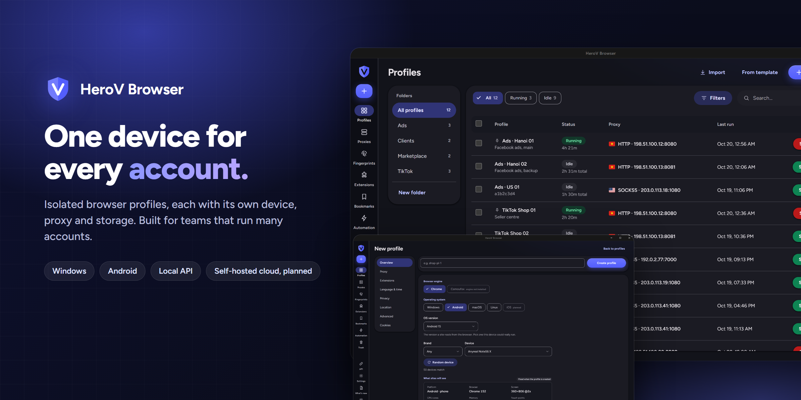
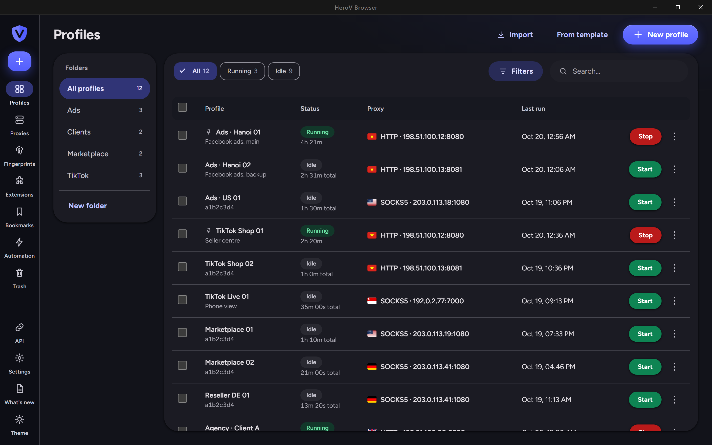
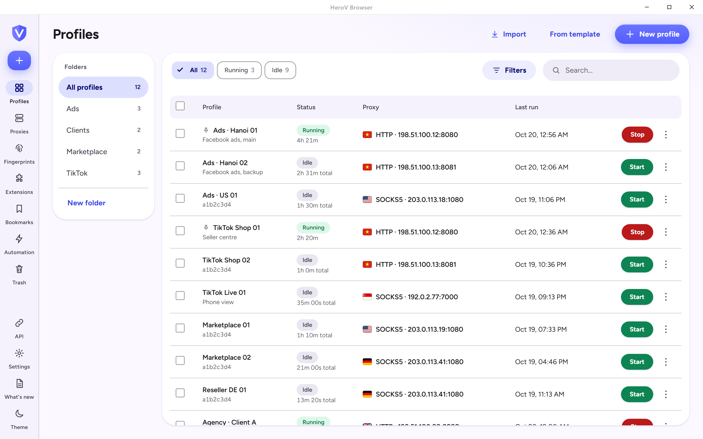
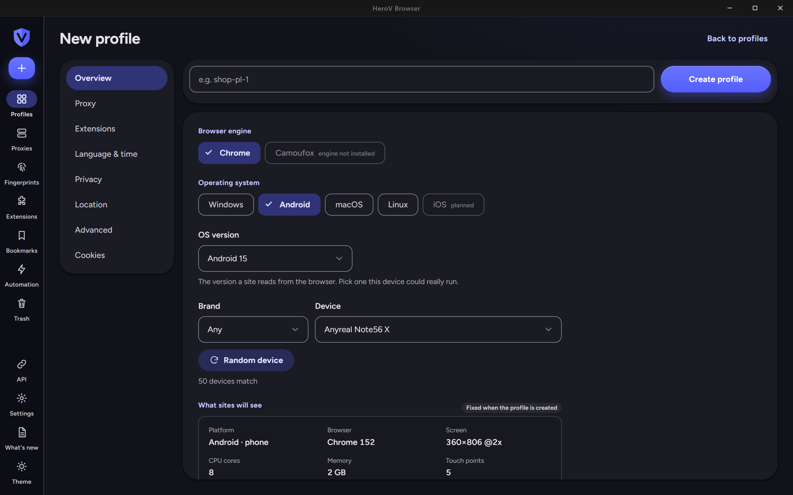
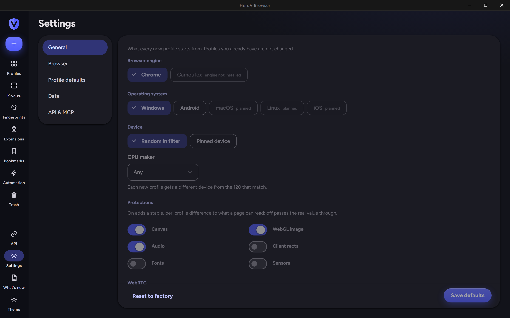
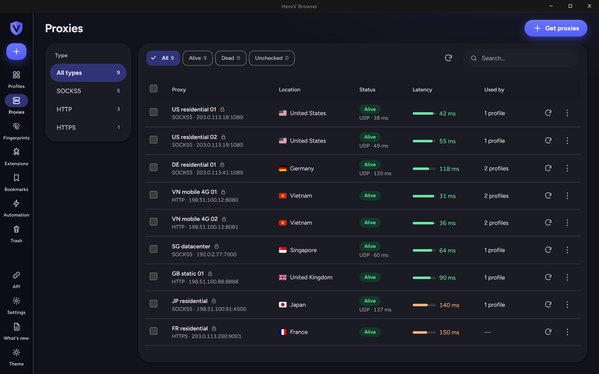

<p align="center">
  
</p>

<h1 align="center">HeroV Browser</h1>

<p align="center">
  <strong>Anti-detect browser for teams that run many accounts.</strong><br>
  Every profile is its own device, with its own proxy, storage and fingerprint.
</p>

<p align="center">
  <a href="https://github.com/phuducnguyen/ShardBrowser/releases"></a>
  <a href="LICENSE"></a>
  
  <a href="https://github.com/phuducnguyen/ShardBrowser/commits/main"></a>
</p>

<p align="center">
  <a href="#what-it-does">What it does</a> ·
  <a href="#screenshots">Screenshots</a> ·
  <a href="#status">Status</a> ·
  <a href="#install">Install</a> ·
  <a href="#roadmap">Roadmap</a> ·
  <a href="#for-developers">For developers</a> ·
  <a href="#licence-and-credits">Licence</a>
</p>

---

## What it does

HeroV runs many isolated browser identities side by side on one computer. Each profile gets a complete device: the operating system a site sees, a real device from a library of 220, its screen, GPU, fonts, language and time zone, plus its own proxy, cookies and storage. Nothing is shared between profiles.

The point of the new interface is that you **choose a device, then the rest follows**. Pick Windows or Android, an OS version, a device (or let HeroV pick one at random inside a filter), and the form shows exactly what sites will see before you create the profile.

| | |
|---|---|
| **Device first** | Windows and Android profiles from a 220-device library. OS version, brand or GPU filter, random device, and a read-only "What sites will see" summary. |
| **Profile defaults** | Decide once what every new profile starts from: OS, random or pinned device, protections (canvas, WebGL image, audio, client rects, fonts, sensors), WebRTC, language and time zone. |
| **Proxies** | SOCKS5, HTTP and HTTPS. Bulk import, live test (TCP, UDP and location), assign to profiles, and see which profiles use each proxy. |
| **Workspace** | Folders, search and filters, running and idle views, bulk actions, cookie import and export, extensions library, bookmarks, and a trash that keeps deleted profiles for 7 days. |
| **Local API and MCP** | Create, start and stop profiles from code and get a CDP endpoint. The API and the MCP server for AI assistants are bundled. |
| **Interface** | Light and dark themes, English, Tiếng Việt and 中文. |

## Screenshots

<p align="center">
  
  
</p>
<p align="center">
  
  
</p>
<p align="center">
  
</p>

<sub>Captured from the built interface with sample data (documentation-range addresses and invented profile names).</sub>

## Status

HeroV is an early release. This table says what is ready and what is not.

| Area | State |
|---|---|
| Profiles, proxies, fingerprints, extensions, bookmarks, trash, settings | New interface, in this release |
| Create profile, device first: **Windows** | Ready |
| Create profile, device first: **Android** | **Experimental.** Public fingerprint checkers such as CreepJS flag the current Android entries because their graphics parameters are not captures of real devices. Real-device captures are on the roadmap. Android and iOS profiles will be part of the Pro tier. |
| macOS and Linux profiles (Chrome engine) | Planned |
| **Camoufox engine** (Firefox, second engine, Windows only) | **Experimental, on the main branch, not in a release yet.** Install it from Settings → Browser (1.3 GB download), then pick it when creating a profile. Proxies work through a local relay; extensions, bookmarks, cookie files and automation are Chrome-only for now. See [the spec](docs/specs/second-engine-camoufox.md). |
| iOS profiles | Planned |
| Automation, live view, traffic panel, window synchroniser | Work, but still the previous interface and partly English |
| Cloud sync and teams | Specified, not built. See [the spec](docs/specs/cloud-sync.md) |
| Installer signing | Not signed yet: Windows SmartScreen will warn |

Windows entries tested against CreepJS came out clean (3 of 3 sampled). Details and method: [docs/references/creepjs-findings.md](docs/references/creepjs-findings.md).

## Install

1. Download `HeroV-Browser-…-x64-setup.exe` from [Releases](https://github.com/phuducnguyen/ShardBrowser/releases) and run it.
2. Windows SmartScreen will show *Windows protected your PC* because the installer is not signed yet. Choose **More info**, then **Run anyway**.
3. On first start the app downloads the browser engine (about 150 MB) and the device library, then opens the workspace. You need an internet connection for this step.

HeroV keeps its data in `%APPDATA%\shardx-launcher\`. This is the same folder the original ShardX Launcher uses, so the two share profiles: if you also run ShardX, close it before starting HeroV.

### Build from source

```bash
npm install
npm run tauri dev       # development, hot reload
npm run tauri build     # release installer in src-tauri/target/release/bundle/
```

Needs Node 22+, Rust (stable) and the Tauri 2 prerequisites for your OS. Checks used before a release: `npm test`, `npm run check:i18n`, `npm run check:fingerprints`.

## Roadmap

The order was chosen so that team and cloud features, the biggest differentiator, come first.

| Version | Theme |
|---|---|
| 0.1.0 | New interface, device-first profiles, profile defaults, Vietnamese (this release) |
| 0.2.0 | Cloud alpha: self-hosted server (Rust, axum), encrypted sync of profiles and their browser data |
| 0.3.0 | Community edition: one-command deployment on your own server |
| 0.4.0 | Teams: roles, sharing, audit log, subscription licensing |
| 0.5.0 | Profile workflow: create many at once, task centre, bulk cookie import, activity history, undo |
| 0.6.0 | Fingerprint quality: real-device captures, isolated-environment checks, Android out of experimental |
| 0.7.0 | Automation and interface polish |

Plans: [editions and Cloud first](plans/261019-herov-gap-roadmap/editions-and-cloud-first.md) · [feature roadmap](plans/261019-herov-gap-roadmap/feature-roadmap.md) · [Cloud spec](docs/specs/cloud-sync.md).

Planned editions: **Community** (self-hosted, free) and **Commercial** (subscription, with hosted cloud, team roles, automation and higher limits). Pricing is not set.

## For developers

The local API, the MCP server, the SDKs and the browser engine behave as in the project HeroV is built on. Their documentation is kept in [docs/engine-and-api-reference.md](docs/engine-and-api-reference.md) (the original ShardX Launcher README), with the API schema in [openapi.yaml](openapi.yaml) and the MCP setup in [mcp/README.md](mcp/README.md).

Notes for contributors: the interface follows the HeroV design system in [docs/design-system/](docs/design-system/) and [docs/design-guidelines.md](docs/design-guidelines.md); feature specs are in [docs/specs/](docs/specs/); release notes are in [docs/releases/](docs/releases/). The SDK packages named in the reference (`shardx` on PyPI, crates.io and npm) are the upstream project's, not HeroV's.

## Licence and credits

- **Launcher source** (the Tauri shell, React interface and Rust code in this repository) is under the **MIT licence**, see [LICENSE](LICENSE).
- HeroV Browser is built on **ShardX Launcher** by the ProxyShard team (MIT). Their copyright and licence notice are kept, and their work is the foundation of the profile, proxy and API features here.
- The **Camoufox** engine is [Camoufox](https://github.com/daijro/camoufox) by daijro and contributors (Mozilla Public License 2.0). HeroV downloads it unmodified from its GitHub releases and checks it against a pinned SHA-256. The device library it uses comes from Camoufox's Python package (MIT); see `src-tauri/src/camoufox/data/NOTICE.md`.
- The **browser engine** is a separate, closed-source patched Chromium that the app downloads on first run. It is distributed by its authors under its own terms, which restrict reverse engineering, redistribution of modified copies, and its use inside a commercial anti-detect product or service. The summary is in the licensing section of [docs/engine-and-api-reference.md](docs/engine-and-api-reference.md#licensing); read it before building anything commercial on top.
- The licence of the future Community edition will be published with that release.
